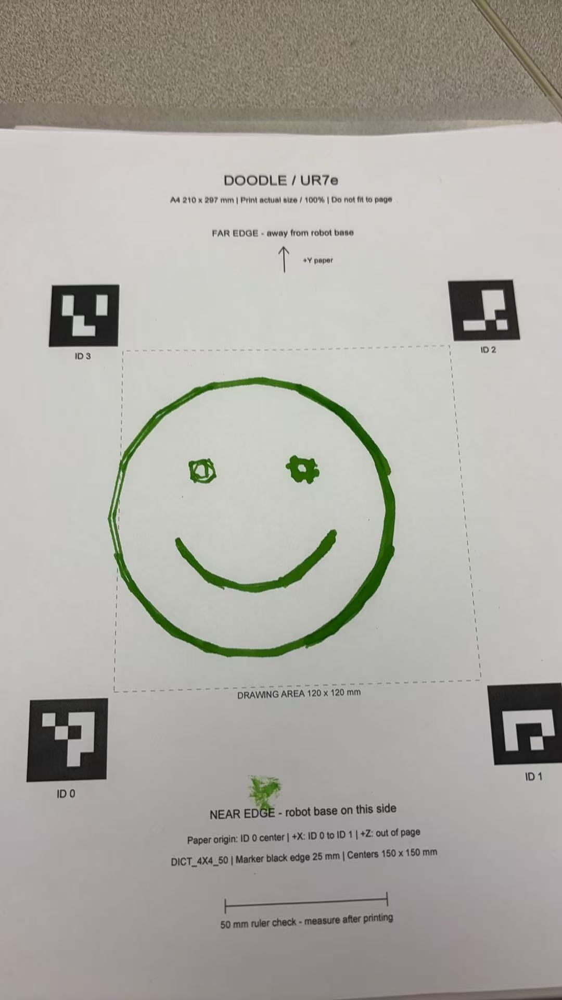

# Doodle_Ur7e

[简体中文](README.md) · **English**

**UC Berkeley · EECS 106 Final Project · Introduction to Robotics**

Doodle_Ur7e is a robotic drawing system that turns a digital image into pen strokes on paper. A UR7e holds the pen, a wrist-mounted Intel RealSense D435i detects four ArUco markers on the sheet, and ROS 2 Humble with MoveIt translates the drawing into robot motion.

## Hardware Demo

The UR7e draws a smiley face on an A4 marker board. The drawing plays at **5×** speed, followed by a photo of the finished result.

| Hardware Demo · 5× | Finished Drawing |
| :---: | :---: |
| https://github.com/user-attachments/assets/4e70dbe8-b4d5-4a94-be58-0d529350e264 |  |

## From Image to Paper

1. **Prepare an image.** Choose a local image or use the optional Baymax interface to generate and confirm one. The system extracts contours and turns them into a sequence of drawing strokes with pen lifts between them.
2. **Locate the drawing area.** The wrist camera detects four ArUco markers on an A4 sheet. The system estimates the paper pose in the robot base frame and maps the strokes into the central 120 × 120 mm drawing area.
3. **Plan and draw.** The system converts the strokes into pen-tip targets and adds approach and lift motions. MoveIt plans the full trajectory and checks it for collisions, then the UR trajectory controller executes it.

## Isaac Sim Demo

The same workflow runs in Isaac Sim. The panel on the right shows the recorded pen-tip path. The video plays at **60×** speed.

https://github.com/user-attachments/assets/a8bf325a-bb5c-4368-9122-c668cab0786e
