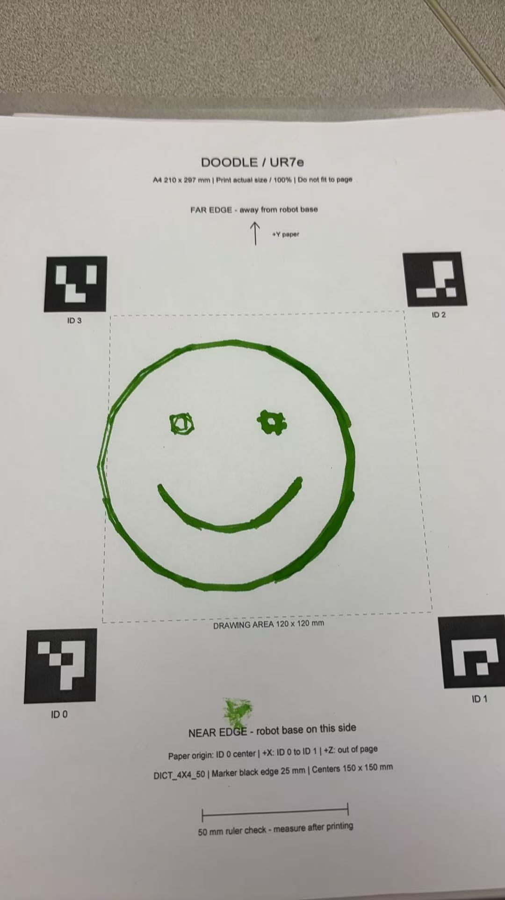

# Doodle_Ur7e

**简体中文** · [English](README.en.md)

**UC Berkeley · EECS 106 期末项目 · Introduction to Robotics**

Doodle_Ur7e 是一个从数字图像到纸面笔迹的机械臂绘画系统。UR7e 夹持画笔，腕部 Intel RealSense D435i 识别纸张上的四个 ArUco 标记，ROS 2 Humble 与 MoveIt 将图像转换成机械臂可以执行的绘画动作。

## 真机演示

UR7e 在 A4 标记板上绘制笑脸。绘画片段为 **5×** 倍速，片尾展示实拍成品。

| 真机视频 · 5× | 实拍成品 |
| :---: | :---: |
| https://github.com/user-attachments/assets/4e70dbe8-b4d5-4a94-be58-0d529350e264 |  |

## 从图像到纸面

1. **准备图像。** 选择本地图像，或通过可选的 Baymax 交互生成并确认图像。系统从图像提取轮廓，转换为有抬笔和落笔动作的笔画序列。
2. **定位绘图区。** 腕部相机读取 A4 纸上的四个 ArUco 标记。系统把相机估计的纸面位姿转换到机械臂底座坐标系，并将笔画映射到中央 120 × 120 mm 绘图区。
3. **规划并绘画。** 将每条笔画转换为笔尖目标，加入悬空移动和抬笔动作。MoveIt 计算并检查完整轨迹，UR 轨迹控制器执行绘画。

## Isaac Sim 仿真

同一绘画流程也可在 Isaac Sim 中演示。画面右侧显示仿真中记录的笔尖轨迹，视频以 **60×** 倍速播放。

https://github.com/user-attachments/assets/a8bf325a-bb5c-4368-9122-c668cab0786e
