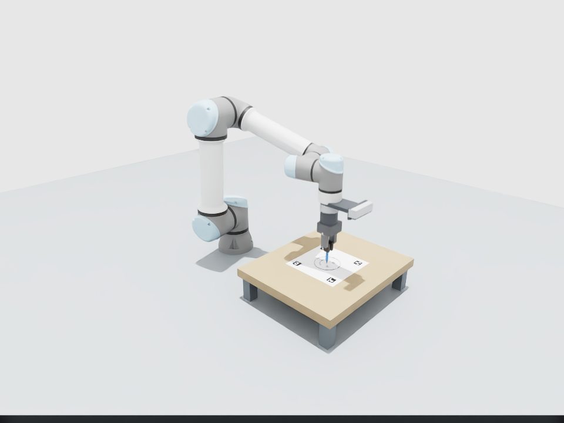

# Isaac Sim 仿真（ROS 2 Humble）

本流程使用 Isaac Sim 5.1.0、官方 UR7e URDF、Humble MoveIt、真正的 controller_manager、joint_state_broadcaster 和 **ur_controllers/ScaledJointTrajectoryController**。新增硬件插件只把关节命令传给 Isaac 的物理关节驱动、把实际关节状态传回 ROS，并提供固定 1.0 的模拟速度缩放状态。没有连接 UR 控制柜，也没有复现 UR 硬件 SDK、保护停止或安全速度缩放逻辑。

## 数据流

相机渲染 RGB → 原有 ArUco/PnP/曝光时间 TF 标定 → 原有笔画与笛卡尔规划 → MoveIt 完整路径与碰撞检查 → UR scaled controller → 仿真硬件插件 → Isaac 关节驱动 → 实际笔尖轨迹 → 墨迹和误差评估。

仿真真实纸面坐标只在标定后做误差核对，不能直接替代相机识别。关节命令通过 `apply_action` 作用于物理驱动；只有初始化姿态会直接设置关节位置。墨迹由实际腕部姿态与 TCP 求得，仅在纸内、笔尖高度距纸面不超过 0.8 mm 时记录。它是几何接触墨迹模型，不是实测笔压、摩擦或墨水物理模型。夹爪按预先夹笔设置，不运行开合动作。

相机发布 RGB、深度、CameraInfo，与 wrist TF 连接。当前相机内参、夹爪外形、工位几何沿用明确的模拟参数；不能把它们当作现场测量。D435i 固件、双目匹配噪声和 IMU 不在本次验证范围内。

## 场景与固定夹持



`sim/scene_geometry.py` 统一定义桌面、纸面、观察姿态和支架碰撞包络。机器人底座位于地面 z=0；独立四脚矮桌顶面 z=0.12 m，尺寸 0.48×0.40 m，纸位于桌面。修改桌高应通过共享常量生成配置并重新规划、标定和验收。这是为当前朝下持笔姿态选择的可达工位，不能直接当作现场桌高。地面碰撞包络顶面留 2 mm 安装容差，避免固定底座与地面的接触被当作碰撞。

腕部保留圆柱电机主体、掌部和闭合双指，笔杆夹在指垫之间；笔与夹爪刚性随腕部运动，TCP 仍为腕部局部 `[0, 0, 0.22]` m。相机由安装板和立板连接到腕部，外壳、镜头与渲染相机位置一致。夹爪及支架为参考照片的近似几何，不是已确认型号的厂商 CAD；碰撞规划使用包络盒。没有模拟夹爪闭合过程或夹持摩擦。

Lab5 的 `static_tf_transform.py` 明确配置了 `wrist_3_link → camera_depth_optical_frame` 的平移 `[-0.025, 0.13, 0]` m 和单位旋转。TF 可读取该关系，但不会自动测量安装外参。本仿真沿用这一配置作为渲染光学坐标；真实彩色/深度光学坐标关系仍应由现场 RealSense TF 和手眼标定核验。

## 环境与入口

实验室 ROS 终端依然先执行：

```bash
distrobox enter ros2
source /opt/ros/humble/setup.bash
cd ~/ros_workspaces/Doodle_Ur7e
colcon build --symlink-install
source install/setup.bash
```

Isaac Sim 使用自己的 Python 3.11 和内置 Humble bridge，ROS 工作区使用 Humble 的 Python 3.10；二者通过 DDS 通信，不能混用 Python 环境。仿真固定 `ROS_DOMAIN_ID=231`、localhost UDP；不要把该配置带入真机流程。两个容器使用相同 UID 和专属共享 IPC，避免 Fast DDS 跨用户共享内存传输失败，网络发现通过 `ROS_LOCALHOST_ONLY=1` 限定在本机。

A6000 主机上的自动运行入口（在 **主机 shell**，不是 Isaac 容器内）：

```bash
cd /home/msc-auto/Harroldx/Doodle_Ur7e
DOODLE_GPU=0 bash sim/run_server.sh
```

先取得该 GPU 的资源使用许可。服务器已有 `doodle-ur7e-sim:validated` 和 `nvcr.io/nvidia/isaac-sim:5.1.0` 镜像。ROS 仿真镜像在原 Humble 验证镜像上增加 ffmpeg，可用 `docker build --network host -t doodle-ur7e-sim:validated - < sim/Dockerfile.ros` 重建。脚本不安装 Distrobox、不更改现场环境；它用隔离的 Humble 容器测试相同 ROS 软件栈。现场 Distrobox 的版本一致性仍需部署时核对。新建运行不会覆盖已有结果，须先归档 `runs/isaac`。首次渲染会编译 shader 缓存。

手动拆分时，在 Humble 环境执行 `python3 sim/prepare.py`、`python3 sim/initial_pose.py`、图片 prepare，然后启动 Isaac 的 `sim/world.py`，最后在 Humble 环境执行 `python3 sim/run_ros.py`。所有工作目录均为仓库根；双方的路径挂载须一致，生成的导入 URDF 含绝对网格路径。

## 结果与检查

输出在 `runs/isaac/`：

- `world.log`、`ros.log`、控制器/MoveIt 日志：实际运行证据。
- `camera_before.png`、`paper.yaml`：渲染观测与识别标定；`environment: isaac` 的标定不能用于真机执行。
- `drawing/plan.json`：路径完整率、执行状态、实际下发的轨迹。
- `actual_tip.csv`：物理引擎实际笔尖与关节状态；不是目标轨迹。
- `actual_drawing.png`、`metrics.json`：实际笔迹与双向路径误差。
- `frames/`、`drawing.mp4`：原始渲染过程；2 Hz 仿真采样、24 fps 视频，标注 12 倍时间压缩。
- `drawing_60x.mp4`：60 倍时间压缩的展示视频，右侧由实际笔尖采样绘制笔迹小窗。小窗与画面同步误差不超过一个 0.5 秒仿真采样周期，不作为误差指标输入。
- `scene.usda`：调试场景快照；正式运行从 URDF 和配置重建场景。

验收包括真实控制器执行成功、完整规划、相机纸面位置误差 ≤2 mm、实际与目标笔迹双向 95 分位距离 <2 mm。模拟通过不替代真实 TCP/手眼/纸面标定和低速悬空验收。

## 版本依据

- [Isaac Sim 5.1 ROS 环境](https://docs.isaacsim.omniverse.nvidia.com/5.1.0/installation/install_ros.html)
- [Isaac 相机 ROS 接口](https://docs.isaacsim.omniverse.nvidia.com/5.1.0/ros2_tutorials/tutorial_ros2_camera.html)
- [Isaac MoveIt 对接](https://docs.isaacsim.omniverse.nvidia.com/5.1.0/ros2_tutorials/tutorial_ros2_moveit.html)
- 实际安装包的 URDF、SRDF、kinematics.yaml、ur_controllers.yaml，以及 Isaac 5.1 随镜像提供的 API 与示例是实现核对依据；没有使用新版 Isaac 的 in-process ros2_control 扩展。

## 监控与停止

`runs/isaac/containers.txt` 记录本次两个容器名称。使用 `docker logs <名称>` 检查容器状态，细节日志在上述目录。运行程序对 SIGINT/SIGTERM 保留 ROS context，以便先取消 action、确认终态，再关闭自己启动的节点。不要按进程名批量杀进程，也不要停止其他实验。

相机初始标定阶段保持 2 Hz 发布；执行期间图像降低至 0.2 Hz，录像仍为 2 Hz。深度仅在有订阅者时发送，避免无用的大消息传输。仿真暂停和渲染开销不会改变 MoveIt 的速度约束，控制器使用 `/clock`。
