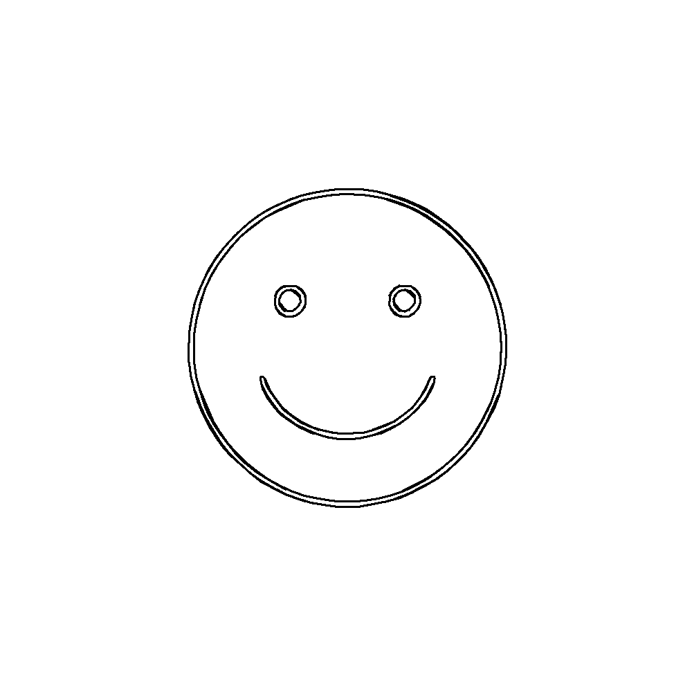

# 验证记录

## 2026-11-24：当前工位真机小脸与回归

操作者确认最后一次小脸完整执行成功。本地 `runs/smiley-contact-20261124-140300/plan.json` 为 `executed: true`、`fraction: 1.0`、223点，名义时长262.57秒。使用有效TCP `[0,0,0.259]`m、`hover=0`、滑块80%；典型绘画约328秒，加安全返回起点约6分钟。早期取消的试画不计入完整成功。

以后统一以笔尾（远离笔尖的一端）直接抵住法兰盘再夹紧，作为重复定位基准。259mm包含本工位间隙校准残差，不是独立机械TCP测量，也不能推广到任意笔或安装。无笔压闭环，没有负hover硬压；换笔、偏心、安装或纸张移动后仍需复核。

本轮软件验证：

- `bash scripts/test_humble.sh`：59项通过，包含三次插值关节速度/加速度、URDF笔尖导数界、只读服务有限重试、缺少本地输入即停止、保存起点拒绝覆盖、真机工具拒绝合成/仿真纸面，以及五个现场工具的无机器人CLI入口。
- `scripts/verify_moveit.py` 在 `ROS_LOCALHOST_ONLY=1 ROS_DOMAIN_ID=231` 隔离域使用官方UR7e模型，100mm悬空和接触路径完整通过，有意障碍 `fraction=0` 被拒绝。不启动真机驱动或发送运动action。
- 重新生成 `images/external/smiley.png` 的31条笔画，与最后现场采用的笔画逐项一致。
- 被动记录工具在当前相机完成4秒实测，保存28帧、MP4、逐帧时间戳和正常结束的rosbag；没有发送运动。
- 当前脚本每次从实时状态规划；保存的是起点姿态，不直接回放保存的关节轨迹。几何计时同时覆盖MoveIt名义URDF和驱动工厂标定URDF；二者的约1mm模型差异并未被假称为消除。

现场标定、保存姿态、图片帧、录像、rosbag和原始执行报告只保留在本地 `runs/`，不随Git发布。真机成功依据操作者验收和本地action终态；不宣称所有工位接触安全或毫米级绝对精度。操作入口见 [START](../START.md)。

## 2026-10-13：初始离线验证（以下为当时记录）

验证日期：2026-10-13（America/Los_Angeles）。环境：a6000 的本任务独立 Docker 容器，Ubuntu 22.04 / Python 3.10.12 / ROS 2 Humble。未启动真实机器人驱动，未连接真实机器人，未使用 GPU。实验室的 ros2 Distrobox 尚未直接访问。

已安装并使用：

| 组件 | 验证版本 |
|---|---|
| moveit_ros_move_group | 2.5.10-1jammy.20261006.010000 |
| ur_description | 2.13.0-1jammy.20260908.015646 |
| ur_moveit_config | 2.15.0-1jammy.20261006.195018 |
| OpenCV | 4.5.4（Ubuntu python3-opencv，含 aruco） |
| Python | 3.10.12 |

## 已执行结果

1. `colcon build --symlink-install --packages-select doodle_ur7e` 成功。
2. `python3 -m pytest tests -q`：**21 passed**。涵盖：
   - 笔尖XYZ偏移、纸面倾斜/法向抬笔、抬笔连接、起点高度、越界与非法输入；
   - 端点反转排序、三次时间参数化的速度/加速度上界、关节跳变拒绝；
   - 合成投影的四标记 PnP，测量平移误差小于3mm；缺标记和空图拒绝；图像转换确定性及比例；
   - 真实 Humble DDS 下的假服务/action：默认不执行、显式执行成功、partial path 拒绝、未验证配置/合成纸面拒绝、场景不匹配拒绝、物体 pose 归一化、action 失败与超时取消。
3. `ros2 run` 的 preview、board、prepare 入口通过；附带 `--ros-args` 的 launch CLI 解析通过。
4. 自制笑脸图片转换得到 **22 条笔画**，输出 SVG 已查看；四标记打印板布局已查看。Canny 轮廓法可能产生双边线，这属于算法效果而非真实笔画质量保证。
5. `scripts/verify_moveit.py` 使用**官方 UR7e 模型及实际 MoveIt IK、FK、碰撞场景和 Cartesian path 服务**：
   - 合成纸面、小方框和短线、10mm 悬空：完整路径，91个关节点，保守时间233.1秒；
   - 相同合成纸面、零悬空：完整路径，93个关节点，保守时间243.8秒；
   - 添加有意遮挡工具路径的碰撞盒：`fraction=0.0`，应用拒绝；即使 MoveIt error_code=SUCCESS，也不会执行不完整轨迹。
   - 两条完整轨迹的末端 FK 在请求笔尖位置2mm以内。该脚本 `execute=False`，不启动硬件驱动，不发送运动 action。
6. Python compileall 通过；项目没有运行中的 MoveIt 或 robot_state_publisher 测试进程遗留。

第三项和第四项不是相机实拍，第二项中的 action 是假服务，第五项才使用真实逆解/规划器。它们均不能证明真实接触高度、夹持稳定性和绘画精度。

## 复现

已有 Humble 开发环境：

```bash
./scripts/test_humble.sh
source /opt/ros/humble/setup.bash
source install/setup.bash
ROS_LOCALHOST_ONLY=1 ROS_DOMAIN_ID=231 python3 scripts/verify_moveit.py
```

可用 `scripts/Dockerfile.humble` 建立依赖环境。服务器已保存本次测试环境镜像 `doodle-ur7e-humble:validated`；在服务器项目目录运行：

```bash
docker run --rm --network none --user "$(id -u):$(id -g)" \
  -e HOME=/tmp -e ROS_LOCALHOST_ONLY=1 -e ROS_DOMAIN_ID=231 \
  -v "$PWD:/workspace" -w /workspace doodle-ur7e-humble:validated \
  bash scripts/test_humble.sh
```

原测试因服务器 docker0 不存在使用 host 网络，但仅 localhost + 独立 domain；复现推荐 `--network none`。Docker 用于服务器离线检查，不替代真机 Distrobox 运行流程。镜像已有来源环境层，正式重新构建可用本仓库 Dockerfile；Dockerfile 本身不是逐层重建验证结果。

`runs/real_moveit/{air,contact}/plan.json` 是服务器实际规划记录，`runs/real_moveit/move_group.log` 是最后一次规划器日志。依赖安装日志与测试日志保存在服务器 runs/ 中，未上传到 GitHub。

## 已知限制与现场验收

- 未在课程工作站实际进入 Distrobox、连接 D435i、加载课程 ur7e_utils 或真机控制器。
- 模型使用默认 UR7e 运动学；真实机器人出厂校准、安装、TCP、笔弹性和相机外参误差仍需现场核验。Lab5 近似相机平移不够作为精细绘画精度保证。
- 无接触力反馈；零 hover 的合成规划成功不表示实体笔不会撞桌。需校准纸面高度并先悬空、小图试验。
- 起点到首点的通路及全图工作空间以真实场景为准。MoveIt 为离散规划，不能替代现场障碍检查与急停监督。
- 保守逐点停止的时间参数化牺牲速度，复杂图片可能超过配置的7200秒限制。先减少笔画和绘制面积，不盲目提升速度。
- 本次 MoveIt 二进制在部分测试结束收到 SIGINT 时出现析构阶段崩溃日志。规划服务已完成且结果通过检查，进程均已退出；没有将退出阶段表现写成干净关闭，也未修改上游二进制。后续现场若出现相同退出问题，应报告课程环境维护者。

实际绘画需依次完成 README 与 calibration.md 的测量、RViz检查、悬空方框、纸面方框和人像验收，分别记录位置误差、漏画/连线、接触稳定性、耗时。当前不宣称真实绘画精度或成功率。

## 2026-10-14：复审问题修复验证

P1 已修复：CLI 自行接收 SIGINT/SIGTERM，不提前销毁 ROS context。已发送但仍等待接受的目标，在中断或接受超时后进入有界清理：等待迟到接受回复、取消本次目标、确认终态；未确认时明确提示物理急停，不报告停止成功。

Humble 容器中重新 colcon build 与完整回归：**25 passed**。新增4项通过真实 CLI 子进程测试：接受前 SIGINT、接受前 SIGTERM、执行中 SIGINT，以及接受等待超时后收到迟到 ACCEPT。均确认假控制器收到取消且 CLI 收到 STATUS_CANCELED；未将未完成任务记为 executed。原有21项仍通过。日志：服务器 `runs/stop-fix-tests.log`。

P2 已补齐：README 第3节包含 Lab5 同接口的显式 SwitchController 请求与 list_controllers 状态核验。请求字符串已用实际 Humble `SwitchController.Request` 和 ROS 字段转换器解析验证；没有对真机发送该请求。

这些改动不改变图像算法、纸面变换或轨迹规划，因此沿用此前实际UR7e MoveIt几何验证，不重复声称新增真机证据。无限网络延迟、服务端失联或进程被 SIGKILL 无法靠客户端保证停止，物理急停要求保持不变。

## 2026-10-14：Isaac Sim 全流程执行

实际运行环境：A6000 GPU 0（用户允许共享）、Isaac Sim 5.1.0、Humble 镜像 `doodle-ur7e-sim:validated`。物理步长20 ms，官方 UR7e 模型；controller_manager + 官方 ur_controllers/ScaledJointTrajectoryController + 项目 SystemInterface，未连接真实机器人。

- 原有及新增回归：27 passed；包括仿真域隔离、仿真标定拒绝用于硬件、ROS 命令行参数和真实 CLI 停止信号路径。
- 控制器独立 CPU 合约：实际 scaled controller 接受轨迹，并返回 STATUS_CANCELED。该测试的反馈是确定性模拟，不冒充物理验证。
- 渲染腕部相机12帧标定原点误差：0.5527 mm；深度帧1280×960、32FC1，有效像素100%，该帧中值深度0.2202 m。
- 笑脸输入经现有轮廓算法得到31条笔画；MoveIt完整路径fraction=1.0、1049个轨迹点；实际 action 执行成功。
- 物理运行记录154542个实际笔尖采样，其中83673个满足几何接触条件，生成31段墨迹和6181帧渲染。
- 实际接触笔迹到规划接触路径：RMS 0.1412 mm、P95 0.1724 mm；规划到实际笔迹P95 0.1322 mm。几何墨迹条件为纸内且高度差≤0.8 mm。这些是仿真测量，不能解释为真机精度。
- 完整记录约3090.82秒仿真时间；视频按60倍仿真时间压缩，并明确标注实际笔尖重建小窗。录像不是目标轨迹动画。
- 最终相机碰撞盒调整到与模拟相机外壳相同的中心、保留保守尺寸后，使用真实MoveIt逐点重新检查全部1049个轨迹样本，均通过；此次调整不改变相机外参或执行轨迹。

服务器证据：`/home/msc-auto/Harroldx/Doodle_Ur7e/runs/isaac/{ros.log,world.log,metrics.json,world_result.json,actual_tip.csv,drawing/plan.json,drawing_60x.mp4}`；其他检查在 `runs/{sim-final-tests.log,controller_contract_result.log,collision_revalidation_result.log}`。实际运行配置另保存在 `runs/isaac/config.used.yaml`。模型、夹爪/相机外形与工位为模拟近似；接触墨迹与固定速度缩放不等于真实笔压或真实安全控制器；机械臂仿真禁用了重力，未验证真实重力补偿动力学。



## 2026-10-14: revised scene and image input

The revised scene was rerun through Isaac Sim, Humble MoveIt and the real UR scaled controller. Prior evidence remains in `runs/isaac_v1_validated`; new evidence is in `runs/isaac`.

- Grounded robot base, independent 0.12 m table, fixed camera bracket and closed two-finger pen grip. Gripper geometry approximates the photo; it is not confirmed vendor CAD.
- 12 rendered camera samples: position error 0.6324 mm. Full 1031-point trajectory; action succeeded.
- 2979.60 seconds recorded simulation time, 5959 frames, 80328 measured contact samples. Actual-to-planned RMS 0.1743 mm, P95 0.2267 mm; planned-to-actual P95 0.1372 mm. Acceptance passed.
- The gripper enclosure was widened from 65 to 80 mm to cover tilted finger links. The running trajectory was unchanged; all 1031 points independently passed with the final enclosure. Exact checked boxes are in `collision_validation.json`; execution-time configuration remains separately in `config.used.yaml`.
- Video: `drawing_60x.mp4`, 1280x720, 52.667 seconds. Render and final trace inspected. Local/server SHA256 matched: `96402808c19e909d52734940c96186c42230eee409831c9b366871b8c5dc5382`.

39 Humble tests passed (`runs/baymax_final_tests.log`). New coverage includes offline image import, source preservation, explicit image confirmation, revision invalidation, changed-image rejection, untrusted model text not triggering confirmation, quitting without processing, blank/dense/complex/invalid strokes rejection, API response parsing and missing credentials. Existing action cancellation and signal regressions also pass.

`sim/verify_image_input.py` exercised the new image CLI with actual UR7e MoveIt: the external smiley produced a complete 1031-point plan. Adding an intentional obstacle and requesting `--execute --supervised` was rejected during Cartesian planning, before any action. No hardware/controller/action server was started. Evidence: `runs/baymax_moveit`.

The GPT interface uses `gpt-5.6-sol` with the `gpt-image-2.5-flare` tool, following the checked official schema. No API key is configured, so **live API generation has not been tested**. Dialogue/API tests use fixed responses, not a real model call. After configuring a key, first validate chat, generation and confirmation using `baymax --chat` without ROS or execution flags.

## 2026-10-28: Lab5/Lab7 hardware-interface review

40 Humble regression tests passed, including wrist/root/optical transform composition with non-identity native rotation. Actual UR7e MoveIt produced complete 91-point hover and 93-point contact plans; an intentional obstacle was rejected (fraction 0). No hardware driver or execution action was used. See [review and remaining on-site checks](lab_review.md), [startup entry](../START.md). Evidence: `runs/lab57_review_20261028.log` on the A6000 host. Existing full Isaac evidence remains valid; no GPU rerun was required for these deployment changes.

## 2026-11-03: 100 mm hover

41 regression tests passed. Actual UR7e MoveIt offline validation passed a complete 100 mm hover path (88 points), contact path (105 points), and intentional-obstacle rejection. Added height/clearance/bounds regression; CLI default is now 0.10 m and initial clearance is 0.115 m with the default pen lift. Evidence: `runs/hover100_final.log`. No real hardware motion was performed.
